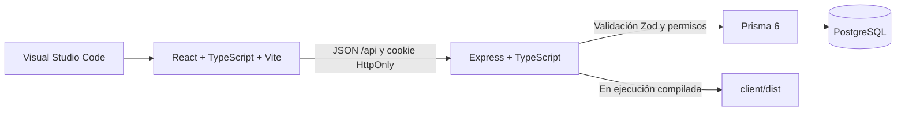
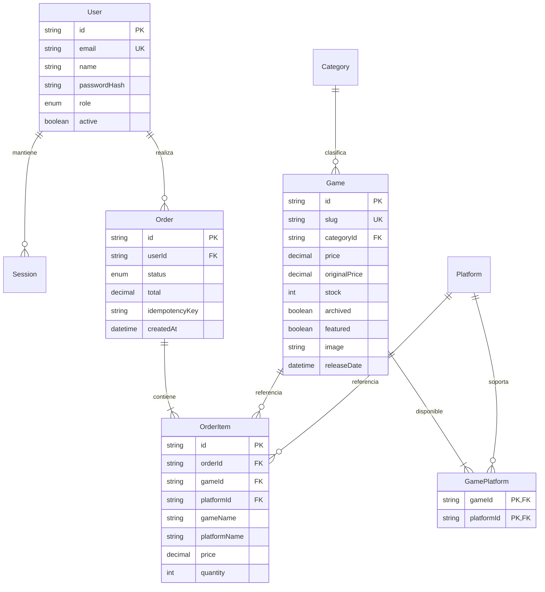

# Arquitectura de NeonPlay

## Aplicaciones y flujo



Vite sirve el frontend en 5173 y reenvía `/api` a Express en 4000. En modo compilado Express sirve `client/dist` y la API en el mismo origen. La configuración local inicializa un clúster independiente en 55432; no usa almacenamiento simulado para el catálogo, las cuentas o los pedidos. Solo el carrito se conserva en el navegador.

## Pantallas

| Ruta                                    | Experiencia                                                | Acceso                     |
| --------------------------------------- | ---------------------------------------------------------- | -------------------------- |
| `/`                                     | Inicio, destacado dinámico, colecciones, géneros y ofertas | Público                    |
| `/catalog`                              | Búsqueda, filtros, ordenamiento y paginación               | Público                    |
| `/game/:slug`                           | Descripción, precio, plataforma y stock                    | Público                    |
| `/cart`                                 | Cantidades, precios actualizados y checkout demo           | Público; compra con sesión |
| `/login`, `/register`                   | Acceso y creación de cuenta                                | Público                    |
| `/account`                              | Perfil y accesos personales                                | Cliente o administrador    |
| `/orders`                               | Historial del usuario conectado                            | Cliente o administrador    |
| `/admin/dashboard`                      | Métricas reales y alertas de inventario                    | Administrador              |
| `/admin/games`                          | CRUD y restauración de juegos archivados                   | Administrador              |
| `/admin/categories`, `/admin/platforms` | CRUD de taxonomías                                         | Administrador              |
| `/admin/users`                          | Cuentas, roles, desactivación y reactivación               | Administrador              |
| `/admin/orders`                         | Pedidos, artículos y cambios de estado                     | Administrador              |

## Modelo relacional



`Order` tiene una restricción única por `userId` e `idempotencyKey`. `GamePlatform` usa una clave compuesta. Los precios usan tipos `Decimal` de PostgreSQL. Las categorías, plataformas y juegos con pedidos tienen relaciones restringidas para evitar referencias rotas.

## API

Todos los cuerpos de escritura son JSON. Los errores regresan `{ "message": "..." }` con código HTTP apropiado.

| Método y ruta                                               | Función                                                        |
| ----------------------------------------------------------- | -------------------------------------------------------------- |
| `GET /api/health`                                           | Comprueba PostgreSQL                                           |
| `GET /api/meta`                                             | Categorías y plataformas                                       |
| `GET /api/games`                                            | `q`, `category`, `platform`, `offers`, `sort`, `page`, `limit` |
| `GET /api/games/:slug`                                      | Juego activo                                                   |
| `POST /api/auth/register`, `/api/auth/login`                | Crear cuenta / iniciar sesión                                  |
| `GET /api/auth/me`, `PATCH /api/auth/me`                    | Leer / editar perfil                                           |
| `POST /api/auth/logout`                                     | Revocar sesión                                                 |
| `GET /api/orders`, `POST /api/orders`                       | Historial propio / comprar                                     |
| `GET /api/admin/dashboard`                                  | Métricas                                                       |
| `GET`, `POST /api/admin/games`                              | Listar / crear                                                 |
| `PUT`, `DELETE /api/admin/games/:id`                        | Editar / eliminar o archivar                                   |
| `POST /api/admin/games/:id/restore`                         | Restaurar                                                      |
| `GET`, `POST /api/admin/categories`, `/platforms`           | Listar / crear                                                 |
| `PUT`, `DELETE /api/admin/categories/:id`, `/platforms/:id` | Editar / eliminar                                              |
| `GET`, `POST /api/admin/users`                              | Listar / crear                                                 |
| `PUT`, `DELETE /api/admin/users/:id`                        | Editar / desactivar                                            |
| `GET /api/admin/orders`, `PATCH /api/admin/orders/:id`      | Consultar / cambiar estado                                     |

Ejemplo de compra:

```json
{
  "idempotencyKey": "UUID-generado-por-el-cliente",
  "items": [
    {
      "gameId": "id-del-juego",
      "platformId": "id-de-plataforma",
      "quantity": 1,
      "expectedPrice": 39.99
    }
  ]
}
```

El servidor valida identificadores CUID y una clave UUID real. La respuesta contiene el pedido, su total y las líneas con precios históricos. La compra demo crea un pedido `COMPLETED`.

## Decisiones

- Sesiones revocables: cerrar sesión o desactivar una cuenta invalida el registro en PostgreSQL.
- Permisos vivos: el JWT no fija el rol; el servidor consulta el usuario actual.
- Dinero en decimal en el servidor y centavos en el cálculo del carrito.
- Inventario compartido por juego entre plataformas, como define el modelo inicial.
- Cancelación transaccional para impedir doble devolución de stock.
- Fechas de lanzamiento tratadas como fechas calendario UTC; las fechas de pedidos se muestran en America/Guayaquil.
- Arte local incluido para que las portadas no dependan de servicios externos.
- Errores de red y validación visibles; rutas desconocidas con una pantalla de recuperación.
